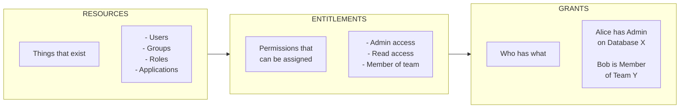
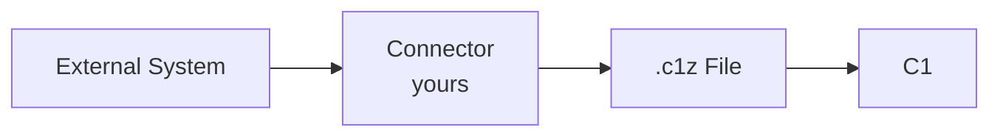

{/* Editor Refresh: 2026-11-12 */}

Every target system has its own vocabulary: teams and groups, roles and permission sets, projects and workspaces. Each system evolved for its own purpose, but the differences make it hard to see who has access to what across all of them.

Baton normalizes every system into a consistent shape, so C1 can ask one question across all systems: who has access to what? Without that normalization, each system would be an island, and an access review would require expert knowledge of every platform.

You express this shape through the SDK's syncer interfaces. For each resource type, you list resources, list entitlements, and list grants. See [Building connectors](/developer/syncing) to implement them.

## The access graph

Your connector produces an access graph that C1 uses for access reviews, provisioning workflows, and reporting. The graph has three node and edge types:



- **Resources** are things that exist: users, groups, apps, roles, projects, and so on.
- **Entitlements** are permissions you can assign on a resource: member, admin, read, and so on.
- **Grants** are facts that connect a principal to an entitlement: Alice is a member of Engineering.

These are concrete protobuf types and services in the SDK, not an abstract model.

### Hierarchical resources

Most access management systems flatten everything into one list. Baton lets resources have parent-child relationships, which preserves the natural structure of your target systems.

Consider GitHub, where organizations contain repositories, or AWS, where accounts contain services and services contain resources. When your connector models these hierarchies, C1 can:

- Show access in context: this role applies to *this* project, not globally.
- Run scoped access reviews, such as reviewing all access within one organizational unit.
- Support inheritance where the target system has it.

Two things express a hierarchy:

- The parent resource carries a `ChildResourceType` annotation for each child type it contains.
- Each child resource sets its parent with `WithParentResourceID`.

The SDK calls `List` with no parent to get the top-level resources. It then calls `List` for each child type of each parent that declares one, and passes the parent's `ResourceId` so you can scope your API call. You describe the structure, and the SDK walks it. See [Modeling hierarchies](/developer/pagination#modeling-hierarchies) for examples.

## Resource types and traits

Every resource has a **resource type**, identified by a string ID. A resource type can declare **traits** that tell C1 how to interpret its resources. Traits let C1 understand *what kind of thing* a resource is, even when different systems call it different names.

```go
var userResourceType = &v2.ResourceType{
    Id:          "user",
    DisplayName: "User",
    Traits:      []v2.ResourceType_Trait{v2.ResourceType_TRAIT_USER},
}
```

| Trait | Use for |
|-------|---------|
| `TRAIT_USER` | Individual accounts |
| `TRAIT_GROUP` | Collections of users |
| `TRAIT_ROLE` | Permission sets |
| `TRAIT_APP` | Applications or services |
| `TRAIT_SECRET` | Credentials or tokens |
| `TRAIT_SCOPE_BINDING` | A role bound to the scope it applies to, such as an Azure role definition scoped to a subscription |
| `TRAIT_SECURITY_INSIGHT` | Security signals about a resource, such as a risk score |
| `TRAIT_AGENT` | Autonomous non-human actors, such as AI agents, that hold an identity |
| `TRAIT_MANAGED_DEVICE` | Managed devices, such as laptops |
| `TRAIT_VENDOR` | Vendors |
| `TRAIT_VENDOR_AGREEMENT` | Agreements with a vendor, such as term, renewal, and value |
| `TRAIT_LICENSE_PROFILE` | License profiles |

Traits are optional for custom resource types, but they unlock features. When you mark a resource with `TRAIT_USER`, C1 can treat it as a user: show it in user-centric views and apply user-specific policies.

<Warning>
If a resource type declares a trait, every resource of that type must carry the matching trait data, or the sync fails with a "resource was missing expected trait" error. Build resources with the trait constructors, such as `resource.NewUserResource`, `NewGroupResource`, and `NewRoleResource`, or add the trait with an option such as `resource.WithUserTrait`. Setting the trait on the resource type isn't enough.
</Warning>

### Entitlements

Entitlements define *what can be granted*. They attach to a resource, because permissions belong to something specific.

```go
// A group offers membership as an entitlement.
member := entitlement.NewAssignmentEntitlement(groupResource, "member",
    entitlement.WithGrantableTo(userResourceType),
    entitlement.WithDisplayName("Member"))
```

One resource can offer several entitlements. A GitHub repository might offer read, write, maintain, and admin.

The second argument is the entitlement's **slug**, a short label that's unique within its resource. The SDK builds the entitlement's ID from the resource type, the resource ID, and the slug, so always create entitlements with the helpers instead of setting `Id` by hand.

#### Entitlement purpose

Each entitlement has a purpose that tells C1 how to interpret it. The constructor you use sets the purpose:

| Purpose | Constructor | Use for | Example |
|---------|-------------|---------|---------|
| `assignment` | `NewAssignmentEntitlement` | Membership or role assignment | "Member of Engineering Team" |
| `permission` | `NewPermissionEntitlement` | A specific permission on a resource | "Read access to Repository X" |
| `ownership` | `NewOwnershipEntitlement` | Ownership or administrative control | "Owner of Project Y" |

### Grants

Grants record *who has what*. A grant connects a **principal**, usually a user, to an entitlement:

```go
// Alice is a member of the engineering team.
g := grant.NewGrant(groupResource, "member", aliceResource)
```

`NewGrant` takes the resource that offers the entitlement, the entitlement's slug, and the principal, which is either a `*v2.Resource` or a `*v2.ResourceId`. It builds the entitlement ID and the grant ID for you. A grant must have an ID, so don't construct `v2.Grant` values by hand.

## The sync lifecycle

The SDK orchestrates the sync, and you implement the callbacks. For each resource type, the work has four parts:

- Define the type (`ResourceType`).
- List the instances (`List`).
- For each resource, list its entitlements (`Entitlements`).
- For each resource, list its grants (`Grants`).

Each paged method returns one page of results and a token for the next page, and the token is empty when there are no more pages.

The SDK runs the connector-facing phases in this order: resource types, resources, entitlements, and grants. It handles each phase for every resource type before it moves to the next, so your connector code stays focused on data transformation instead of orchestration.

```
ResourceType()
  The SDK learns which resource types exist (user, group, role, and so on).

List()
  The SDK fetches every instance of each resource type.

Entitlements()
  The SDK asks each resource which entitlements it offers.

Grants()
  The SDK asks each resource who holds its entitlements.
```

The SDK also runs phases of its own that need no code from you, such as fetching assets, matching external principals, and expanding grants, which resolves nested group membership. It can run some of the work in parallel when you set the `--workers` flag. A sync can also resume from a checkpoint in a new process, so don't assume that anything you cached in memory during `List` is still there when `Grants` runs.

<Note>
The SDK fails the sync when a page returns the same non-empty token it received. It doesn't detect longer loops, such as a token that alternates between two values.
</Note>

### The sync pipeline

When a connector runs, data flows through these stages:



1. **Fetch.** Your connector calls the external API.
2. **Transform.** Your connector creates resource, entitlement, and grant objects.
3. **Output.** The SDK writes the objects to a `.c1z` file.
4. **Ingest.** C1 reads the `.c1z` file and updates its model of access.

You control steps 1 through 3, and C1 controls step 4.

A `.c1z` file is a zstd-compressed archive of the sync data. The current format stores a Pebble checkpoint. Inspect a file with the [`baton` CLI](/developer/intro#understand-the-tools). The current SDK can't read the older SQLite-based format, and it tells you to convert such a file with `baton to-pebble`.

### Resource identifiers

During a sync, the SDK identifies a resource by its `ResourceId`: the resource type ID plus the resource ID you passed to the constructor. Choose a stable, unique value for the resource ID, such as the source system's native identifier, so the same resource gets the same ID on every sync.

You can also attach a `RawId` annotation, which records the identifier that the source system's own API uses for the resource:

```go
r, err := resource.NewGroupResource(
    group.Name,
    groupResourceType,
    group.ID,
    nil,
    resource.WithAnnotation(&v2.RawId{Id: group.ID}),
)
```

The SDK itself doesn't read `RawId`. See [ID correlation recipes](/developer/recipes-id) for when to set it and which value to use. Don't set `ExternalId` on resources, because the SDK marks it deprecated and no longer uses it.

## Modeling decisions

Your modeling choices expand or constrain what your organization can do with access control. Two connectors can both be correct and still give very different experiences in C1:

- **Entitlement granularity.**
  - Fine-grained entitlements (read, write, admin) give you more precision in reviews and provisioning, at the cost of more grants and API calls.
  - Coarse-grained entitlements (access or no access) are simpler, but you can't request or revoke specific privilege levels.
- **Capability surface.** A connector can sync only, or sync and provision (grant, revoke, create, and delete). Check each connector and version instead of assuming.

| Decision | Impact |
|----------|--------|
| **Granular entitlements** (read, write, and admin separately) | More control, more complexity |
| **Coarse entitlements** (access or no access) | Simpler, less visibility |
| **Group membership as grants** | Users can request to join groups |
| **Roles as resources** | Roles can be granted and revoked |

Model what matters for access decisions. If you need to revoke admin access separately from read access, make them separate entitlements.

## Constraints and guardrails

The SDK includes guardrails that catch common mistakes early:

- **Pagination.** The next token must change, or the sync fails.
- **Traits.** A resource must carry the trait that its resource type declares.
- **Skipping work.** Resource types that never have entitlements or grants, such as users in many systems, can carry the `SkipEntitlementsAndGrants` annotation so the SDK doesn't call those methods. `SkipEntitlements` and `SkipGrants` skip one of the two.
- **Optional advanced behavior.** Targeted sync (`Get`), account creation, resource deletion, and credential rotation aren't universal. Start with the basics and add them when you need them.

### Error handling

If an API call fails, return an error. The SDK retries a failed call only when it returns a gRPC `Unavailable` or `DeadlineExceeded` status. Any other error stops the sync. The `uhttp` package translates HTTP statuses such as 429, 502, 503, and 504 into `Unavailable` for you, so use it for API calls. Permanent failures, such as bad credentials or missing permissions, should surface as errors that explain the cause.

### Rate limiting

Most APIs have rate limits. The `uhttp` package can read an API's rate limit headers when you pass the request option for them, and it can limit your request rate on the client side when you enable that. Neither happens by default, so check the `uhttp` options when your API enforces strict limits. Smaller pages mean more requests, so choose page sizes with your limits in mind.

## Execution modes

Connectors can run in different modes:

| Mode | Trigger | Behavior |
|------|---------|----------|
| **One-shot** | No `--client-id` | Runs once, writes a sync file, and exits |
| **Daemon** | `--client-id` and `--client-secret` | Connects to C1 and processes tasks continuously |

Daemon mode needs both the client ID and the client secret, and the connector exits with an error if either is missing. On Windows, a connector that runs as a Windows service always runs in daemon mode.

See [Deployment](/baton/deploy) for operational details on each mode.

## Quick reference

### Resource types

| Type | Description | Example |
|------|-------------|---------|
| User | Individual accounts | alice@company.com |
| Group | Collections of users | engineering-team |
| Role | Permission bundles | admin-role |
| App | Applications | billing-service |
| Team | A custom type for GitHub and Slack-style teams | platform-team |
| Project | A custom type for scoped containers | production-project |

### The four methods

Every resource syncer implements:

| Method | Purpose | Called |
|--------|---------|--------|
| `ResourceType()` | Defines the resource type | Once per sync |
| `List()` | Fetches instances of the type | Repeatedly, once per page |
| `Entitlements()` | Returns the permissions a resource offers | For each resource, once per page |
| `Grants()` | Returns who holds those permissions | For each resource, once per page |
