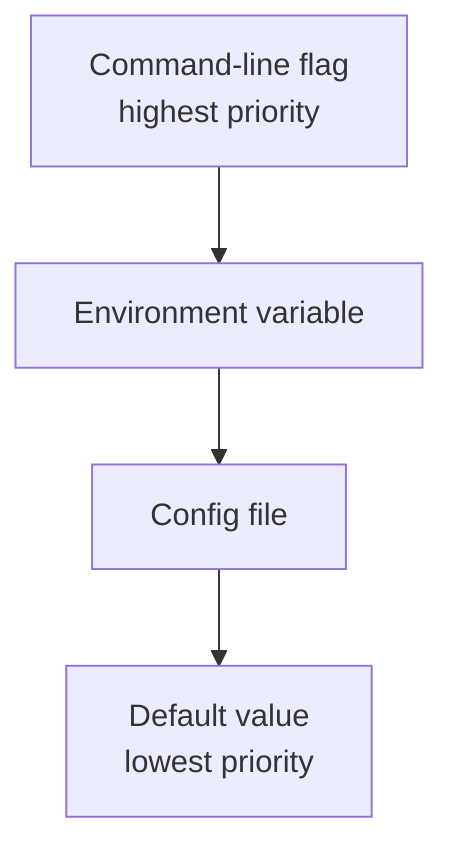

{/* Editor Refresh: 2026-11-12 */}

Every Baton connector uses a type-safe configuration system. Configuration flows through three layers:

1. **Command-line flags** (`--domain example.com`)
2. **Environment variables** (`BATON_DOMAIN=example.com`)
3. **A config file** (YAML)

Flags take precedence over environment variables, which take precedence over the config file. A field's default value applies when none of the three sets it.

## Standard flags (all connectors)

Every connector automatically has these flags through the SDK. Run `./baton-yourservice --help` to see the flags for a specific connector. Hidden flags don't appear there.

### Output and logging

| Flag | Short | Type | Default | Description |
|------|-------|------|---------|-------------|
| `--file` | `-f` | string | `sync.c1z` | Output file path |
| `--log-level` | | string | `info` | `debug`, `info`, `warn`, or `error` |
| `--log-format` | | string | auto | `json` or `console`. The default depends on whether the output is a terminal. |
| `--log-path` | | string list | | File paths to write logs to |

### Daemon mode

| Flag | Type | Default | Description |
|------|------|---------|-------------|
| `--client-id` | string | | C1 OAuth client ID |
| `--client-secret` | string | | C1 OAuth client secret |
| `--skip-full-sync` | bool | `false` | Skip the full sync in daemon mode |
| `--task-concurrency` | int | `3` | Number of tasks to run at once. The range is 1 to 100. |
| `--http-timeout-seconds` | int | `300` | HTTP client timeout. The range is 1 to 1800. |
| `--health-check` | bool | `false` | Enable the HTTP health check endpoint |
| `--health-check-port` | int | `8081` | Port for the health check endpoint |

A connector runs in daemon mode when you set `--client-id`, and it exits with an error unless you also set `--client-secret`. A connector that runs as a Windows service always runs in daemon mode.

### Sync performance

| Flag | Type | Default | Description |
|------|------|---------|-------------|
| `--workers` | int | `0` | Number of sync workers. `-1` detects the number automatically, `0` syncs sequentially, and a positive number syncs in parallel. |
| `--parallel-sync` | bool | | Deprecated. Use `--workers`. |

### Provisioning and operations

| Flag | Short | Type | Description |
|------|-------|------|-------------|
| `--provisioning` | `-p` | bool | Enable provisioning operations |
| `--ticketing` | | bool | Enable ticketing support |
| `--grant-entitlement` | | string | Entitlement ID to grant (hidden) |
| `--grant-principal` | | string | Resource ID receiving the grant (hidden) |
| `--grant-principal-type` | | string | Resource type of the principal (hidden) |
| `--revoke-grant` | | string | Grant ID to revoke (hidden) |
| `--create-account-login` | | string | Login for a new account (hidden) |
| `--create-account-email` | | string | Email for a new account (hidden) |
| `--create-account-profile` | | string | JSON profile data for a new account |
| `--create-account-resource-type` | | string | Resource type for a new account |
| `--delete-resource` | | string | Resource ID to delete (hidden) |
| `--delete-resource-type` | | string | Resource type to delete (hidden) |
| `--rotate-credentials` | | string | Resource ID whose credentials to rotate (hidden) |
| `--rotate-credentials-type` | | string | Resource type of that resource (hidden) |
| `--invoke-action` | | string | Name of a custom action to run |

See [Test provisioning locally](/developer/provisioning#test-provisioning-locally) for how to combine these flags.

### Targeted sync

| Flag | Type | Description |
|------|------|-------------|
| `--sync-resources` | string list | Specific resource IDs to sync |
| `--sync-resource-types` | string list | Resource types to sync |
| `--skip-entitlements-and-grants` | bool | Skip entitlements and grants during the sync |
| `--skip-grants` | bool | Skip only grants |

### OpenTelemetry (operators)

| Flag | Type | Description |
|------|------|-------------|
| `--otel-collector-endpoint` | string | OpenTelemetry collector URL |
| `--otel-tracing-disabled` | bool | Disable tracing |
| `--otel-logging-disabled` | bool | Disable OpenTelemetry logging |

### Built-in subcommands

Every connector also has subcommands. Two are useful while you build:

- `capabilities` prints the capability manifest as JSON.
- `config` prints the configuration schema.

## Environment variables

Every flag maps to an environment variable with the `BATON_` prefix:

```bash
--domain          -> BATON_DOMAIN
--api-key         -> BATON_API_KEY
--skip-ous        -> BATON_SKIP_OUS
--log-level       -> BATON_LOG_LEVEL
--client-id       -> BATON_CLIENT_ID
--client-secret   -> BATON_CLIENT_SECRET
```

**Rules:**
- The prefix is `BATON_`.
- Dashes become underscores: `--base-dn` becomes `BATON_BASE_DN`.
- Use upper case. On systems with case-sensitive environment variables, `baton_domain` doesn't match.

**Example:**

```bash
export BATON_DOMAIN=example.okta.com
export BATON_API_TOKEN=00abc123...
export BATON_LOG_LEVEL=debug

./baton-okta  # Reads the environment variables
```

## Config file format

Connectors read configuration from a YAML file:

```yaml
# .baton.yaml

domain: example.okta.com
api-token: "00abc123..."
log-level: debug

# Lists
skip-groups:
  - "Test Group"
  - "Temp Users"
```

By default, the connector looks for `.baton.yaml` in the current directory. To use a different file, set the `BATON_CONFIG_PATH` environment variable to its path. The file name must end in `.yaml` or `.yml`.

```bash
export BATON_CONFIG_PATH=/etc/baton/okta.yaml
```

## Define your configuration

You declare a connector's configuration fields in `pkg/config/config.go`, group them into a `field.Configuration`, and pass that to `config.RunConnector`:

```go
var Domain = field.StringField(
    "domain",
    field.WithDisplayName("Domain"),
    field.WithDescription("Your Okta domain."),
    field.WithRequired(true),
)

var APIToken = field.StringField(
    "api-token",
    field.WithDisplayName("API token"),
    field.WithDescription("An Okta API token."),
    field.WithRequired(true),
    field.WithIsSecret(true),
)

var ConfigurationFields = []field.SchemaField{Domain, APIToken}

//go:generate go run -tags=generate ./gen
var Config = field.NewConfiguration(
    ConfigurationFields,
    field.WithConnectorDisplayName("Okta"),
)
```

Run `go generate` (or `make generate` in a Starter Pack project) to create `conf.gen.go`. It defines a struct with one typed field for each configuration field, tagged with `mapstructure:"<field-name>"`, and it satisfies the `field.Configurable` interface that `RunConnector` requires. Your connector constructor receives this struct. See [Building connectors](/developer/syncing#define-configuration) for the full setup.

`field.NewConfiguration` also accepts these options: `WithConnectorDisplayName`, `WithHelpUrl`, `WithIconUrl`, `WithCatalogId`, `WithIsDirectory`, and `WithConstraints`, which registers [field relationships](#field-relationships).

## Field types

### StringField

```go
field.StringField("domain",
    field.WithRequired(true),
    field.WithDescription("Your Okta domain"),
    field.WithPlaceholder("example.okta.com"),
)
```

Flag: `--domain example.okta.com`
Environment variable: `BATON_DOMAIN=example.okta.com`

### BoolField

```go
field.BoolField("ldaps",
    field.WithDescription("Use LDAPS encryption"),
    field.WithDefaultValue(false),
)
```

Flag: `--ldaps` or `--ldaps=true`
Environment variable: `BATON_LDAPS=true`

<Warning>
Don't call `WithRequired(true)` on a `BoolField`. The SDK panics when it builds the schema.
</Warning>

### IntField

```go
field.IntField("port",
    field.WithDescription("LDAP port"),
    field.WithDefaultValue(389),
)
```

Flag: `--port 636`
Environment variable: `BATON_PORT=636`

### StringSliceField

```go
field.StringSliceField("skip-groups",
    field.WithDescription("Groups to exclude from sync"),
)
```

Flag: `--skip-groups "Group1" --skip-groups "Group2"`
Environment variable: `BATON_SKIP_GROUPS="Group1,Group2"`

### StringMapField

A map of string keys to values:

```go
field.StringMapField("custom-attributes",
    field.WithDescription("Extra attributes to sync"),
)
```

### SelectField and MultiSelectField

`SelectField` limits a field to one value from a list. `MultiSelectField` allows several:

```go
field.SelectField("auth-type", []string{"token", "oauth", "basic"},
    field.WithDescription("Authentication method"),
    field.WithDefaultValue("token"),
)
```

Flag: `--auth-type oauth`

### Other field types

For specialized inputs, the `field` package also has `MultilineField`, `FileUploadField`, `RandomField`, and `Oauth2Field`.

## Field options

### Required fields

```go
field.StringField("api-key",
    field.WithRequired(true),
)
```

If a required field has no value, the connector exits with an error that names the field and says it's required.

### Secret fields

```go
field.StringField("api-token",
    field.WithIsSecret(true),
)
```

C1 obscures secret fields in its configuration interface.

### Default values

```go
field.IntField("timeout",
    field.WithDefaultValue(30),
)
```

`WithDefaultValueFunc` computes a default when the connector starts, and `WithSuggestedValue` suggests a value in the C1 configuration interface without setting a default.

### Hidden fields

```go
field.StringField("internal-id",
    field.WithHidden(true),  // Not shown in --help
)
```

### Shorthand flags

```go
field.StringField("file",
    field.WithShortHand("f"),  // Enables the -f shortcut
)
```

### Display and metadata options

| Option | Use |
|--------|-----|
| `WithDisplayName` | The name shown in the C1 configuration interface |
| `WithDescription` | Help text for the field |
| `WithPlaceholder` | Example text for an empty input |
| `WithTags` | Tags that categorize the field |
| `WithContentType` | The content type of the field's value |
| `WithStructFieldName` | The name of the generated struct field, instead of the default |
| `WithPersistent` | Whether the flag applies to subcommands too |

### Who sets a field

`WithExportTarget` controls who is expected to set a field:

| Target | Meaning |
|--------|---------|
| `ExportTargetGUI` | A C1 tenant admin, in the web interface. This is the default, and it includes the command line. |
| `ExportTargetOps` | C1 support, for operational settings such as a log level. It includes the command line. |
| `ExportTargetCLIOnly` | Only whoever runs the connector on the command line, for settings such as a file path |

Fields you add to a connector appear in the C1 configuration interface unless you set a different target. Use `ExportTargetCLIOnly` for settings that tenant admins shouldn't see. `WithRequiredInGUI` makes a field required in the interface without making it required on the command line.

## Validation rules

### String validation

```go
field.StringField("domain",
    field.WithString(func(r *field.StringRuler) {
        r.MinLen(3)
        r.MaxLen(253)
        r.Pattern(`^[a-z0-9.-]+$`)
        r.Prefix("https://")
        r.Suffix(".com")
        r.Contains("okta")
    }),
)
```

The string ruler also has `Eq`, `Len`, `NotContains`, and format checks such as `IsEmail`, `IsHostname`, `IsIP`, `IsURI`, and `IsUUID`.

### Integer validation

```go
field.IntField("port",
    field.WithInt(func(r *field.IntRuler) {
        r.Gt(0)
        r.Lt(65536)
        r.Gte(1024)
        r.Lte(49151)
        r.In([]int64{80, 443, 8080})
        r.NotIn([]int64{22, 23})
    }),
)
```

### Other validation

`WithStringSlice`, `WithStringMap`, and `WithBool` accept rules for those field types. `WithStringSlice` supports item-count limits, uniqueness, and rules for each item.

## Field relationships

Relationships constrain which fields can be set together. Register them with `field.WithConstraints` when you build the configuration:

```go
var Config = field.NewConfiguration(
    ConfigurationFields,
    field.WithConstraints(
        field.FieldsRequiredTogether(bindUserField, bindPasswordField),
        field.FieldsMutuallyExclusive(skipGroupsField, onlyGroupsField),
    ),
)
```

### Required together

Both must be provided, or neither:

```go
field.FieldsRequiredTogether(
    bindUserField,
    bindPasswordField,
)
```

### Mutually exclusive

At most one can be provided:

```go
field.FieldsMutuallyExclusive(
    skipGroupsField,
    onlyGroupsField,
)
```

A field marked required can't be part of a mutually exclusive set, because the SDK treats that relationship as invalid.

### At least one required

```go
field.FieldsAtLeastOneUsed(
    apiKeyField,
    oauthTokenField,
    usernameField,
)
```

### Dependent fields

The first list of fields depends on the second. If you set any field in the first list, you must set every field in the second:

```go
field.FieldsDependentOn(
    []field.SchemaField{proxyField},
    []field.SchemaField{proxyUserField, proxyPasswordField},
)
```

The two lists can't share a field.

## Configuration precedence

When the same setting is specified more than one way:



## Quick reference

### Common patterns

| Use case | Flags |
|----------|-------|
| Debug a sync | `--log-level debug` |
| Custom output file | `-f /path/to/output.c1z` |
| Daemon mode | `--client-id ID --client-secret SECRET` |
| Targeted sync | `--sync-resource-types user,group` |
| Test provisioning | `-p --grant-entitlement ENT --grant-principal PRIN --grant-principal-type TYPE` |

### Check connector-specific flags

```bash
./baton-okta --help
./baton-github --help
./baton-aws --help
```
