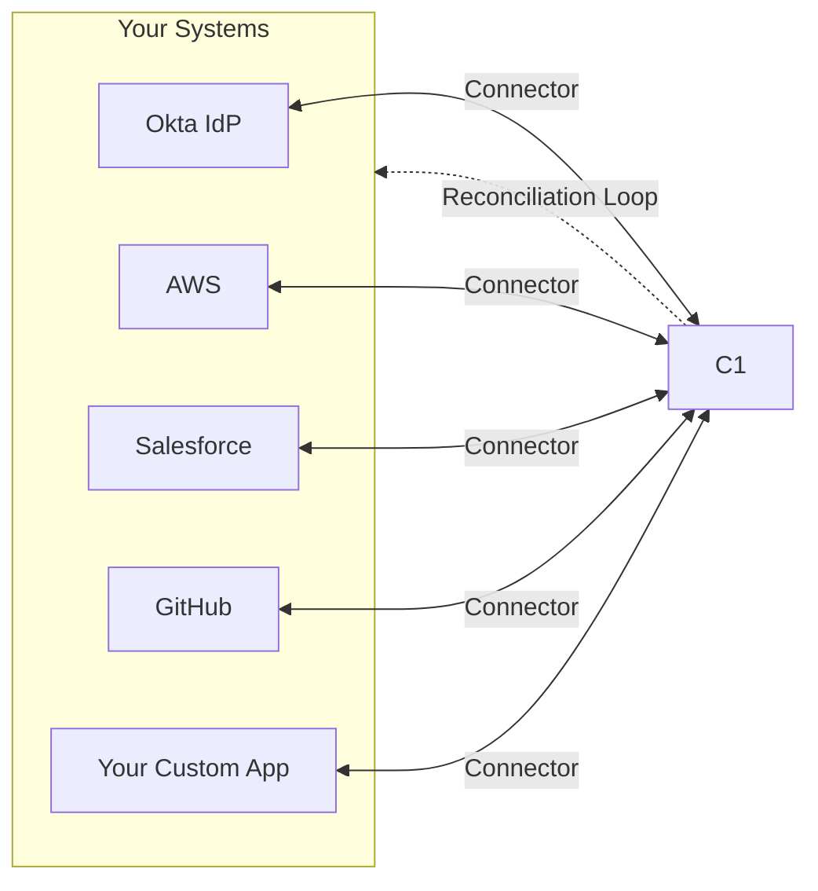

{/* Editor Refresh: 2026-11-12 */}

What happens when an employee leaves your company but still has access to your production database, your billing system, or your customer data? To answer that, C1 needs to know **who has access to what** across all your systems. A **connector** provides that answer for one system.

Every system stores access data differently. Okta has users and groups. AWS has IAM roles and policies. Salesforce has profiles and permission sets. A connector translates a system's access data into a common format that C1 understands, so you get unified visibility across your infrastructure.

In Baton terms, a connector is a program that can:
- **List resources** (users, groups, roles, apps, projects, and so on)
- **Define entitlements** (the permissions you can grant on those resources)
- **Emit grants** (the facts of who currently holds which entitlements)

## Where connectors fit



Most people work with connectors in one of three ways:

- **Deploy an existing connector.** You configure it and don't write code.
- **Build a connector without writing Go.** Use [C1AI custom connectors](/developer/custom-connectors) or a [configuration-driven connector](#when-to-build-and-when-to-reuse).
- **Build or extend a connector in Go.** You write code against `baton-sdk`, which is what the rest of this section covers.

### Sync and provision

Connectors do two things:

**Sync** (read) pulls access data from your systems into C1:
- Who exists? What groups? What roles?
- What permissions are available?
- Who has what access right now?

**Provision** (write) pushes access changes back to your systems:
- **Grant:** Give someone access they've been approved for.
- **Revoke:** Remove access that has been terminated.
- **Create account:** Provision a new account, for example just in time.
- **Delete resource:** Remove accounts entirely.

Together, sync and provision create a **reconciliation loop**. C1 sees what access exists (sync), compares it to what access *should* exist (policy), and corrects any drift (provision).

### The special role of identity providers

Identity providers (IdPs) such as Okta, Azure AD, and Google Workspace are often the **source of truth** for who your users are.

Most connectors sync users *from* the target system. IdP connectors do more:
- They define the canonical user identities.
- Other systems' users are correlated back to IdP users.
- User lifecycle events (join, move, leave) often originate in the IdP.

When you connect an IdP, you establish the identity foundation that other connectors build on.

## Understand the tools

The C1 ecosystem has several SDKs and CLIs with different purposes.

### For connector developers

| Tool | Purpose | When to use |
|------|---------|-------------|
| **baton-sdk** | Go SDK for building connectors | Building or extending a connector |
| **baton** | CLI for inspecting sync output | Debugging `.c1z` files locally |

**baton-sdk** is the Go library you import when you build a connector. It provides:
- The syncer interfaces you implement
- Pagination helpers for API calls
- Resource, entitlement, and grant builders
- HTTP client utilities

```go
import "github.com/conductorone/baton-sdk/pkg/connectorbuilder"
```

**baton** is a standalone CLI for inspecting `.c1z` files. After your connector runs, use it to verify the output:

```bash
baton resource-types -f sync.c1z  # List resource types
baton resources -f sync.c1z       # List synced resources
baton entitlements -f sync.c1z    # List entitlements
baton grants -f sync.c1z          # List grants
baton stats -f sync.c1z           # Show counts by resource type
```

Use `-o json` for machine-readable output. Install `baton` with Homebrew:

```bash
brew install conductorone/baton/baton
```

### For C1 users (not connector development)

| Tool | Purpose | When to use |
|------|---------|-------------|
| **cone** | CLI for the C1 platform | Access requests, approvals, searches |
| **conductorone-sdk-go** | Go SDK for the C1 API | Integrating with the C1 platform |

**cone** is the C1 CLI for end users and administrators. It handles access management workflows:

```bash
cone login <tenant-name>       # Authenticate to your C1 tenant
cone search --query "admin"    # Search for entitlements
cone task approve <task-id>    # Approve an access request
```

See [Command reference](/product/cli/commands) for the full list of `cone` commands.

### Which tool do I need?

| I want to... | Use this |
|--------------|----------|
| Build a new connector | `baton-sdk` |
| Debug my connector's output | `baton` CLI |
| Request or approve access | `cone` CLI |
| Build an app that uses C1 | `conductorone-sdk-go` |
| Deploy a pre-built connector | The connector binary |

<Note>
`cone` and `baton` are separate tools for separate purposes. You don't use `cone` to build connectors, and you don't use `baton` to manage access requests.
</Note>

### The connector binary

When you build a connector, you produce a standalone binary, such as `baton-okta` or `baton-github`. This binary:

- **Embeds the SDK.** It's compiled with `baton-sdk` and doesn't depend on it at runtime.
- **Is self-contained.** It has no runtime dependencies except the target system's API.
- **Runs independently.** You don't need any other C1 tools installed.
- **Produces a sync file.** The output is a `.c1z` file.

```bash
# The connector is the binary
./baton-okta --domain example.okta.com --api-token $TOKEN

# It produces a .c1z file
ls -la sync.c1z
```

The connector is not the SDK. It's the compiled program that uses the SDK.

## The minimum contract

A connector has two parts. The **connector** itself implements `ConnectorBuilderV2`, which declares its metadata, validates its credentials, and lists its resource builders:

- `Metadata(ctx)`: the connector's display name and description
- `Validate(ctx)`: confirms the configured credentials work
- `ResourceSyncers(ctx)`: returns one resource builder per resource type

Each **resource builder** implements `ResourceSyncerV2`:

- `ResourceType(ctx)`: defines the type and traits of a resource (for example, "user" with the trait `TRAIT_USER`)
- `List(ctx, parentResourceID, opts)`: lists instances of that resource type, one page at a time
- `Entitlements(ctx, resource, opts)`: lists the entitlements a resource offers
- `Grants(ctx, resource, opts)`: lists who holds those entitlements

The SDK handles pagination orchestration, retries for transient errors, and output formatting. You translate your target system's API into the common model. Optional interfaces add provisioning and other lifecycle operations when you need them.

See [Building connectors](/developer/syncing) to implement this contract.

## When to build and when to reuse

- **Use an existing connector** when one exists and meets your needs. The cost is configuration and deployment.
- **Use a C1AI custom connector** when the application has an HTTP API with published documentation and you only need to sync access data. C1 builds, tests, and hosts the connector, and you write no code. Custom connectors are in early access and don't support provisioning or custom actions.
- **Use a configuration-driven connector** when you want to write configuration instead of Go: [baton-http](/developer/http-authoring) for REST APIs, [baton-sql](/baton/baton-sql) for SQL databases, or [baton-scim](/baton/baton-scim) for SCIM-enabled applications.
- **Build a connector with the SDK** when the other options can't do what you need, such as custom business logic, a protocol they don't speak, or an authentication method they don't support.

[Choose how to connect an application](/baton/connection-options) compares all of these options. Connector capabilities vary across the ecosystem, so if you need provisioning, check for it per connector and version.

## What a working connector looks like

`baton-demo` is an example connector with sample data that demonstrates a fully runnable sync. It needs no API credentials, so you can try it now.

```bash
brew install conductorone/baton/baton conductorone/baton/baton-demo

baton-demo
baton resources
```

`baton-demo` writes its sync output to `sync.c1z` in the current directory, and `baton` reads that file by default. You can also run both from Docker:

```bash
docker run --rm -v $(pwd):/out ghcr.io/conductorone/baton-demo:latest -f "/out/sync.c1z"
docker run --rm -v $(pwd):/out ghcr.io/conductorone/baton:latest -f "/out/sync.c1z" resources
```

`baton resources` prints one row for each resource, with the columns **ID**, **Display Name**, **Resource Type**, and **Parent Resource**. `baton grants` prints one row for each grant, with the columns **ID**, **Resource Type**, **Resource**, **Entitlement**, and **Principal**. Use `baton stats` to see how many resources a sync produced for each resource type.

## What "working" doesn't guarantee

- **Running locally doesn't mean it's safe in production.** You still need to handle pagination, retries, and rate limits, and verify that you do.
- **Syncing doesn't imply provisioning.** Many connectors are read-only or partially provisionable. Check each connector.
- **Documentation tables aren't the contract.** Capability tables on the docs site are a directory for people. Use the connector's own capability manifest and the SDK interfaces as ground truth.

<Warning>
Connectors sync access data, not business data. Users, roles, permissions, and API keys belong in a connector. Customer records, issues, messages, and logs don't.
</Warning>

## Prerequisites for building

To build a connector in Go, you need:

| Tool | Version | Purpose |
|------|---------|---------|
| Go | The version in `baton-sdk`'s `go.mod` | Connector runtime |
| Git | Any | Version control |
| make | Any | Build automation |

Go version requirements change with SDK releases. Check the `go` directive in `baton-sdk`'s `go.mod` for the minimum version.

You also need:
- Access to the system you want to connect to
- API credentials with read permissions
- An IDE with Go support, such as VS Code or GoLand

## Quick reference

| Term | Meaning |
|------|---------|
| Connector | A Go binary that syncs access data into C1 and can provision access changes |
| c1z | The compressed sync output file |
| Resource | A user, group, role, or custom entity |
| Entitlement | A permission that can be granted |
| Grant | The assignment of an entitlement to a principal |
| Baton SDK | The Go library that handles sync orchestration |
| Sync | Reading access data from a system |
| Provision | Writing access changes back (grant, revoke, create, delete) |
| Reconciliation | Comparing actual access to desired access and correcting drift |
