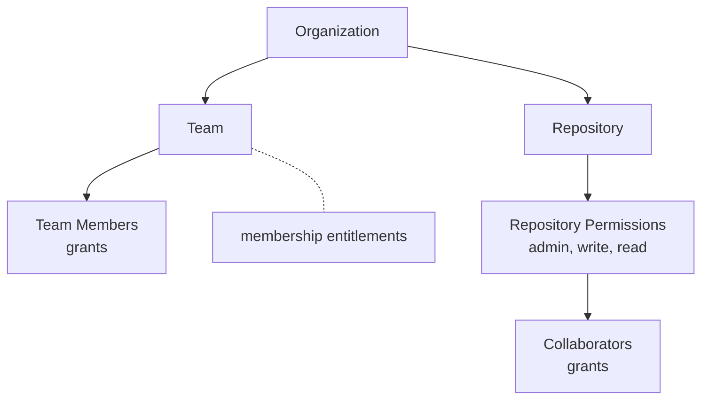

{/* Editor Refresh: 2026-11-12 */}

Always paginate. Even if your test environment has 10 users, production might have 10,000. The SDK coordinates pagination for you, so use it from the start.

## Basic pattern

Every `List`, `Entitlements`, and `Grants` method returns one page of results and a token for the next page. The SDK passes the token you returned back to your next call in `opts.PageToken.Token`:

```go
// Ask for another page by setting a token. Return an empty token when done.
return resources, &resource.SyncOpResults{NextPageToken: nextPage}, nil
```

The SDK calls your method repeatedly until you return an empty token, so your job is to fetch and convert one page at a time. The examples on this page use the V2 method signatures. The V1 interface differs only in how it passes and returns the token. See [V1 syncer differences](/developer/syncing#v1-syncer-differences).

<Tip>
**Use the API's next token to decide when to stop**, not the result count. Some APIs return empty pages before the final page, so `len(results) < pageSize` isn't reliable. Return an empty token only when the API signals there are no more pages.
</Tip>

### Page size

The SDK passes the page size it wants in `opts.PageToken.Size`, which is 0 when the SDK doesn't specify one. The SDK asks for at most 250 items per page. Use it when your API takes a page size, and fall back to a default:

```go
limit := opts.PageToken.Size
if limit == 0 {
    limit = 100
}
```

## Pagination strategies

APIs paginate results differently. Your connector converts the token to whatever the API expects:

| Strategy | How it works | Example APIs |
|----------|--------------|--------------|
| **Cursor-based** | Opaque token in the response | Most modern APIs (Slack, Stripe) |
| **Offset-based** | `?offset=100&limit=50` | Traditional REST APIs |
| **Page number** | `?page=3&per_page=50` | Some REST APIs |
| **Link header** | RFC 5988 link relations | GitHub API |
| **LDAP paging** | Server-side cookie | Active Directory |
| **GraphQL cursors** | `after: "cursor"` | GitHub GraphQL, Shopify |

### Cursor-based

When the API returns an opaque cursor, pass it straight through as the next page token:

```go
func (u *userBuilder) List(ctx context.Context, _ *v2.ResourceId, opts resource.SyncOpAttrs) ([]*v2.Resource, *resource.SyncOpResults, error) {
    resp, err := u.client.ListUsers(ctx, opts.PageToken.Token)
    if err != nil {
        return nil, nil, err
    }

    var resources []*v2.Resource
    for _, user := range resp.Users {
        r, err := resource.NewUserResource(user.Name, userResourceType, user.ID, nil)
        if err != nil {
            return nil, nil, err
        }
        resources = append(resources, r)
    }

    // The API returns an opaque cursor for the next page, or "" on the last page.
    return resources, &resource.SyncOpResults{NextPageToken: resp.NextCursor}, nil
}
```

### Offset-based

Store the next offset as the token:

```go
func (u *userBuilder) List(ctx context.Context, _ *v2.ResourceId, opts resource.SyncOpAttrs) ([]*v2.Resource, *resource.SyncOpResults, error) {
    limit := opts.PageToken.Size
    if limit == 0 {
        limit = 100
    }

    offset := 0
    if opts.PageToken.Token != "" {
        var err error
        offset, err = strconv.Atoi(opts.PageToken.Token)
        if err != nil {
            return nil, nil, fmt.Errorf("invalid page token: %w", err)
        }
    }

    resp, err := u.client.ListUsers(ctx, offset, limit)
    if err != nil {
        return nil, nil, err
    }

    var resources []*v2.Resource
    for _, user := range resp.Users {
        r, err := resource.NewUserResource(user.Name, userResourceType, user.ID, nil)
        if err != nil {
            return nil, nil, err
        }
        resources = append(resources, r)
    }

    // Use the API's total count to know when to stop.
    nextToken := ""
    if offset+len(resp.Users) < resp.Total {
        nextToken = strconv.Itoa(offset + len(resp.Users))
    }

    return resources, &resource.SyncOpResults{NextPageToken: nextToken}, nil
}
```

If the API has no total count, a full page (`len(resp.Users) == limit`) is a fallback signal. That fallback costs one extra request when the last page is exactly full.

### Link header

For APIs that return the next page in an RFC 5988 `Link` header, the `uhttp` package parses the header for you. `uhttp.WithNextLinkPagination` pushes the `rel="next"` URL onto the bag you pass it, so give it a new bag and return that bag as the next token:

```go
next := &pagination.Bag{}
_, err := client.Do(req,
    uhttp.WithJSONResponse(&users),
    uhttp.WithNextLinkPagination(next, nil))
if err != nil {
    return nil, nil, err
}

// Marshal returns "" when the response had no next link.
nextToken, err := next.Marshal()
if err != nil {
    return nil, nil, err
}
```

On the next call, read the URL back with `bag.PageToken()` after you unmarshal the token. See [Nested pagination with Bag](#nested-pagination-with-bag).

For APIs that can silently drop their cursor, `uhttp.WithPaginationData` makes the request fail when a successful response has no pagination data. Without it, the sync ends after one page and looks complete.

### LDAP paging

LDAP servers return a paging cookie. Encode it as the token:

```go
func (u *userBuilder) List(ctx context.Context, _ *v2.ResourceId, opts resource.SyncOpAttrs) ([]*v2.Resource, *resource.SyncOpResults, error) {
    const pageSize = 1000
    pagingControl := ldap.NewControlPaging(pageSize)

    // Restore the cookie from the previous page.
    if opts.PageToken.Token != "" {
        cookie, err := base64.StdEncoding.DecodeString(opts.PageToken.Token)
        if err != nil {
            return nil, nil, fmt.Errorf("invalid page token: %w", err)
        }
        pagingControl.SetCookie(cookie)
    }

    searchRequest := ldap.NewSearchRequest(
        "dc=example,dc=com",
        ldap.ScopeWholeSubtree, ldap.NeverDerefAliases, 0, 0, false,
        "(objectClass=user)",
        []string{"distinguishedName", "sAMAccountName", "mail"},
        []ldap.Control{pagingControl},
    )

    result, err := u.conn.Search(searchRequest)
    if err != nil {
        return nil, nil, err
    }

    var resources []*v2.Resource
    for _, entry := range result.Entries {
        r, err := resource.NewUserResource(
            entry.GetAttributeValue("sAMAccountName"),
            userResourceType,
            entry.GetAttributeValue("distinguishedName"),
            nil)
        if err != nil {
            return nil, nil, err
        }
        resources = append(resources, r)
    }

    // Extract the cookie for the next page.
    nextToken := ""
    if ctrl := ldap.FindControl(result.Controls, ldap.ControlTypePaging); ctrl != nil {
        if pc, ok := ctrl.(*ldap.ControlPaging); ok && len(pc.Cookie) > 0 {
            nextToken = base64.StdEncoding.EncodeToString(pc.Cookie)
        }
    }

    return resources, &resource.SyncOpResults{NextPageToken: nextToken}, nil
}
```

## Nested pagination with Bag

When a single call needs to page through more than one thing, one string isn't enough state. For example, "page through the admins of a group, then page through its members" needs to remember which list you're in and where you are in it. The SDK's `pagination.Bag` holds that state as a stack and serializes it into the page token.

### How Bag works

A `Bag` is a stack of `PageState` values. The top of the stack is the current state:

```go
type PageState struct {
    Token          string // Page token for the current list
    ResourceTypeID string // Free-form label you can use to track which list you're paging
    ResourceID     string // Free-form label, such as the ID of the parent you're paging
}
```

| Method | What it does |
|--------|--------------|
| `Unmarshal(token)` | Restores the bag from the token you returned on the previous call. An empty token gives an empty bag. |
| `Current()` | Returns a copy of the current state, or nil if the bag is empty. |
| `PageToken()`, `ResourceTypeID()`, `ResourceID()` | Return the fields of the current state, or `""` if the bag is empty. Use them to avoid nil checks. |
| `Push(state)` | Pushes a new state, which becomes current. |
| `Pop()` | Removes the current state, so the one below it becomes current. |
| `NextToken(nextPage)` | Replaces the current state's token with `nextPage` and returns the serialized bag. If `nextPage` is empty, it pops the current state instead. Returns `""` when no states remain. |
| `Next(nextPage)`, `Marshal()` | The same two steps as `NextToken`, separately. |

Prefer `NextToken`. It does the advance and the serialization in one call, and its return value is the page token you hand back to the SDK.

<Warning>
**Push an initial state before you call `NextToken`.** An empty bag has no state to advance, so `NextToken` starts a new state that holds whatever token you pass, even an empty one. Check `bag.Current() == nil` after you unmarshal, and push the starting state if it's nil.
</Warning>

### Page through one list

The pattern for a single list is: unmarshal, push an initial state if the bag is empty, fetch with the current token, and advance with `NextToken`.

```go
func (r *repoBuilder) List(ctx context.Context, parentID *v2.ResourceId, opts resource.SyncOpAttrs) ([]*v2.Resource, *resource.SyncOpResults, error) {
    bag := &pagination.Bag{}
    if err := bag.Unmarshal(opts.PageToken.Token); err != nil {
        return nil, nil, err
    }
    if bag.Current() == nil {
        bag.Push(pagination.PageState{})
    }

    repos, nextPage, err := r.client.ListRepos(ctx, parentID.Resource, bag.PageToken())
    if err != nil {
        return nil, nil, err
    }

    var resources []*v2.Resource
    for _, repo := range repos {
        res, err := resource.NewResource(repo.Name, repoResourceType, repo.ID,
            resource.WithParentResourceID(parentID))
        if err != nil {
            return nil, nil, err
        }
        resources = append(resources, res)
    }

    nextToken, err := bag.NextToken(nextPage)
    if err != nil {
        return nil, nil, err
    }

    return resources, &resource.SyncOpResults{NextPageToken: nextToken}, nil
}
```

### Page through several lists

To page through two lists in one method, push one state per list. The state you push last is current, so it's processed first. When a list runs out, `NextToken("")` pops its state, and the next call continues with the list below it:

```go
func (g *groupBuilder) Grants(ctx context.Context, res *v2.Resource, opts resource.SyncOpAttrs) ([]*v2.Grant, *resource.SyncOpResults, error) {
    bag := &pagination.Bag{}
    if err := bag.Unmarshal(opts.PageToken.Token); err != nil {
        return nil, nil, err
    }
    if bag.Current() == nil {
        // First call: page through admins, then members.
        bag.Push(pagination.PageState{ResourceTypeID: "members"})
        bag.Push(pagination.PageState{ResourceTypeID: "admins"})
    }

    var (
        slug     string
        members  []*client.Member
        nextPage string
        err      error
    )
    switch bag.ResourceTypeID() {
    case "admins":
        slug = "admin"
        members, nextPage, err = g.client.ListGroupAdmins(ctx, res.Id.Resource, bag.PageToken())
    case "members":
        slug = "member"
        members, nextPage, err = g.client.ListGroupMembers(ctx, res.Id.Resource, bag.PageToken())
    default:
        return nil, nil, fmt.Errorf("unexpected pagination state %q", bag.ResourceTypeID())
    }
    if err != nil {
        return nil, nil, err
    }

    var grants []*v2.Grant
    for _, m := range members {
        grants = append(grants, grant.NewGrant(res, slug,
            &v2.ResourceId{ResourceType: userResourceType.Id, Resource: m.ID}))
    }

    nextToken, err := bag.NextToken(nextPage)
    if err != nil {
        return nil, nil, err
    }

    return grants, &resource.SyncOpResults{NextPageToken: nextToken}, nil
}
```

If your state needs more than a token and two labels, `pagination.GenBag[T]` holds a stack of your own struct type. Create one with `pagination.GenBagFromToken[T](&opts.PageToken)`.

### Expired page tokens

Some APIs reject a cursor after a period of time. When the API rejects the token the SDK gave you, return a restart error from `List`, `Entitlements`, or `Grants` instead of failing the sync:

```go
return nil, nil, pagination.NewRestartActionError(restartToken, "cursor expired")
```

The SDK restarts the call at `restartToken`. An empty `restartToken` restarts from the first page. The restart only works when the error comes straight from one of those list calls, and any other source fails the sync.

## Modeling hierarchies

Real systems often have deep hierarchies. Declare the parent-child relationships, and the SDK walks the tree for you.

### Two mechanisms connect parent and child

**1. The parent declares its child types** with the `ChildResourceType` annotation:

```go
org, err := resource.NewResource("Acme Corp", orgResourceType, "org-123",
    resource.WithAnnotation(
        &v2.ChildResourceType{ResourceTypeId: "repository"},
        &v2.ChildResourceType{ResourceTypeId: "team"},
    ))
```

**2. The child references its parent** with `WithParentResourceID`:

```go
repo, err := resource.NewResource("api-service", repoResourceType, "repo-456",
    resource.WithParentResourceID(org.Id))
```

When the SDK calls `List` for a child type, it passes the parent's `ResourceId`, so you can scope your API call to that parent.

### Example: GitHub hierarchy



**Organization builder:**

```go
func (o *orgBuilder) List(ctx context.Context, _ *v2.ResourceId, opts resource.SyncOpAttrs) ([]*v2.Resource, *resource.SyncOpResults, error) {
    orgs, next, err := o.client.ListOrganizations(ctx, opts.PageToken.Token)
    if err != nil {
        return nil, nil, err
    }

    var resources []*v2.Resource
    for _, org := range orgs {
        r, err := resource.NewResource(org.Name, orgResourceType, org.ID,
            // Declare the child types.
            resource.WithAnnotation(
                &v2.ChildResourceType{ResourceTypeId: "team"},
                &v2.ChildResourceType{ResourceTypeId: "repository"},
            ))
        if err != nil {
            return nil, nil, err
        }
        resources = append(resources, r)
    }

    return resources, &resource.SyncOpResults{NextPageToken: next}, nil
}
```

**Repository builder, which receives the parent organization in `List`:**

```go
func (r *repoBuilder) List(ctx context.Context, parentID *v2.ResourceId, opts resource.SyncOpAttrs) ([]*v2.Resource, *resource.SyncOpResults, error) {
    // parentID.Resource is the organization ID.
    repos, next, err := r.client.ListOrgRepos(ctx, parentID.Resource, opts.PageToken.Token)
    if err != nil {
        return nil, nil, err
    }

    var resources []*v2.Resource
    for _, repo := range repos {
        res, err := resource.NewResource(repo.Name, repoResourceType, repo.ID,
            resource.WithParentResourceID(parentID)) // Link to the parent organization.
        if err != nil {
            return nil, nil, err
        }
        resources = append(resources, res)
    }

    return resources, &resource.SyncOpResults{NextPageToken: next}, nil
}
```

### When to use hierarchies and when to use flat models

| Use hierarchies when... | Use flat models when... |
|------------------------|------------------------|
| Resources only exist within a parent (repos in orgs) | Resources are independent (standalone users) |
| The API requires parent context to list children | The API lists all resources globally |
| Access is scoped by parent (org-level vs repo-level) | Access is global |
| You need to express "admin of org X" and "admin of repo Y" | All instances have the same entitlement shape |

## Common hierarchy mistakes

| Mistake | Consequence | Fix |
|---------|-------------|-----|
| Missing `ChildResourceType` annotation | The SDK never calls `List` for the children | Add the annotation to the parent |
| Wrong type in the parent's `ResourceId` | The child appears orphaned | Match the exact resource type ID string |
| Not using `parentID` in `List` | The call returns all resources, not just the parent's children | Scope the API call to the parent |
| Flat model for hierarchical data | You lose context, such as which org owns a repo | Add parent-child links |
| Over-deep hierarchies | Sync takes too long | Flatten where parent context isn't needed |

## Pagination invariants

The SDK checks for common pagination bugs:

- **The token must change.** If a page returns the same non-empty token it received, the sync fails with a "next page token unchanged" error. The SDK doesn't detect longer loops, such as a token that alternates between two values.
- **An empty token means done.** Return `""` when there are no more pages.
- **Respect the requested page size.** Use `opts.PageToken.Size` when your API takes a page size.

<Tip>
Test with small page sizes (10 to 20 items) during development to verify that pagination works before you test with production-sized datasets.
</Tip>
