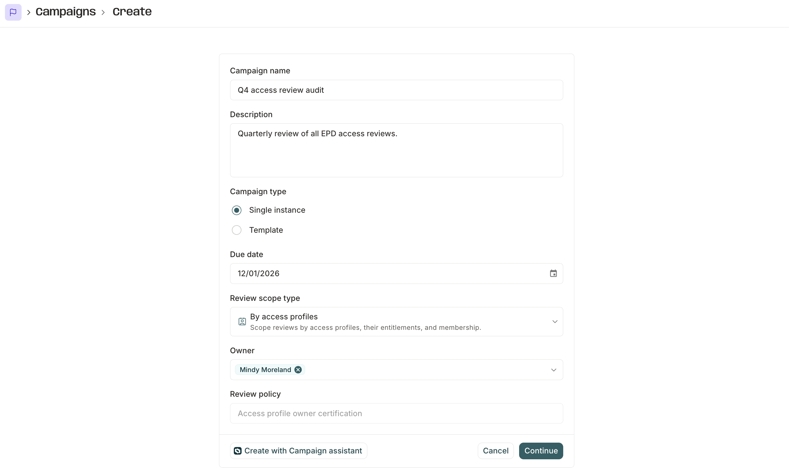
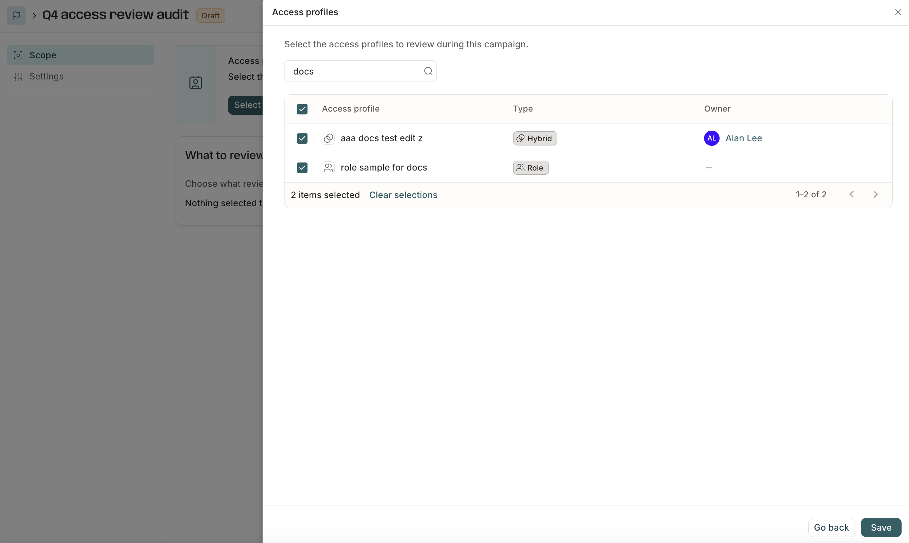
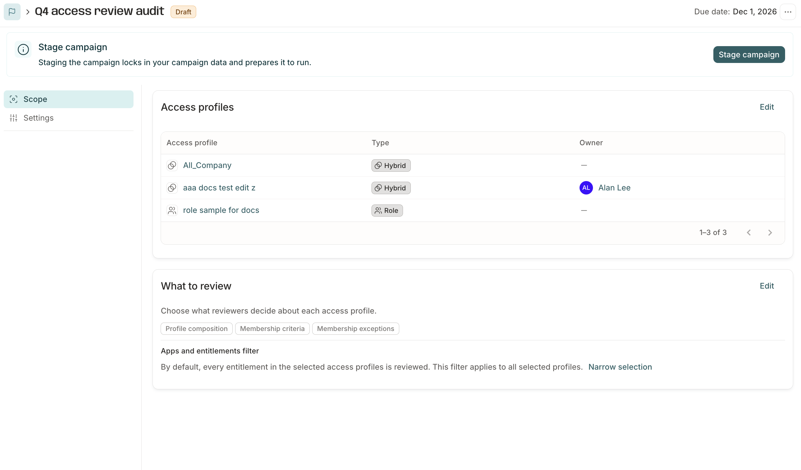
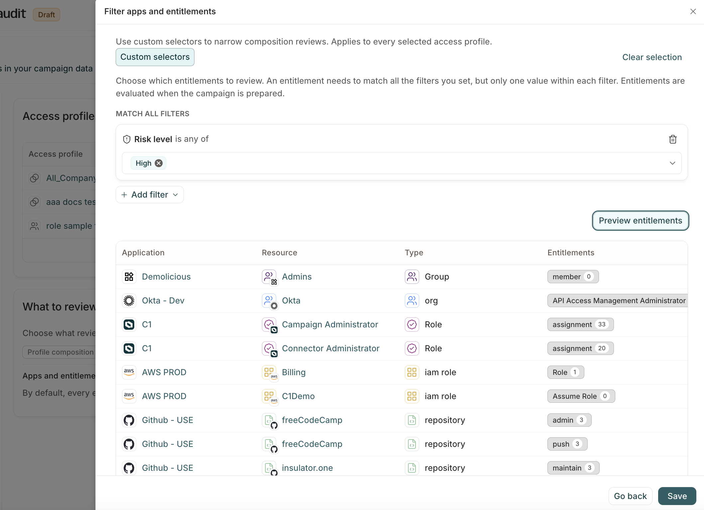
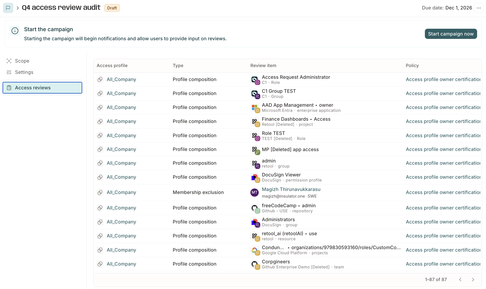
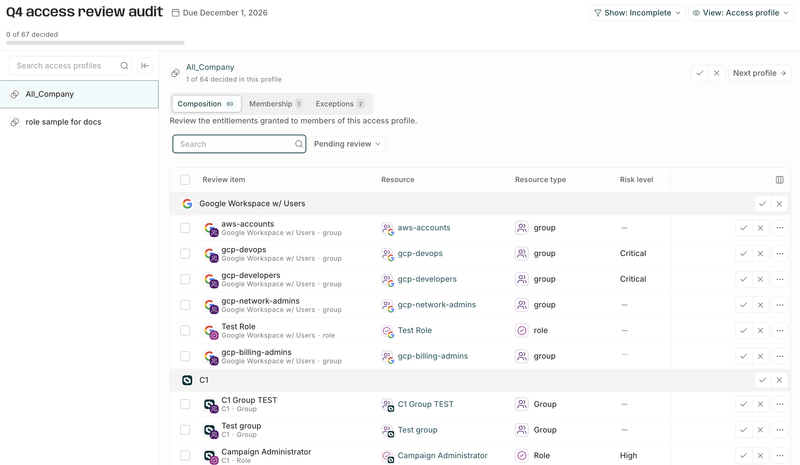
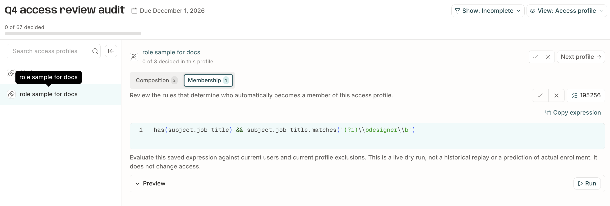
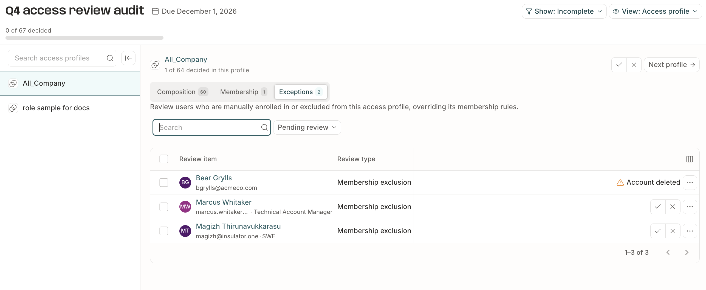

{/* Editor Refresh: 2026-11-24 */}

An [access profile](/product/admin/profiles) gives everyone enrolled in it the same bundle of access, so one outdated entitlement or overly broad membership rule affects every member. Use the **By access profiles** scope type to review the profiles themselves: the entitlements each profile grants, the rules that enroll people in it automatically, and the people who were added to or excluded from it outside those rules. Reviewers decide whether each part of a profile is still appropriate, and C1 asks the profile's owners to make any changes the reviewers call for.

## When to use scope by access profiles

Use **By access profiles** when:

- You want to confirm that each profile grants only the access its members still need.
- You want to check the rules that enroll people in a profile automatically.
- You want to audit the people who were added to a profile manually, or excluded from it, outside its rules.
- You want each profile's owner to decide whether it's still right.

These campaigns review the profile's definition, not the individual grants each member holds as a result. To review the grants themselves, use the standard **By entitlements** scope type.

## What reviewers decide

A **By access profiles** campaign can cover three areas of each profile. You choose which areas to include when you set up the campaign.

| Area | What reviewers decide |
|---|---|
| **Profile composition** | Whether each entitlement the profile grants should still be part of it. |
| **Membership criteria** | Whether the rules that decide who is enrolled automatically are still correct. |
| **Membership exceptions** | Whether each person who was enrolled in the profile manually, or excluded from it, should stay that way. |

<Note>
Review membership exceptions on their own when you want to find stale one-off decisions. A manual enrollment or exclusion overrides the profile's rules, so it's easy to forget once the person's situation changes.
</Note>

## Set up a campaign scoped by access profiles

Follow these steps to create a single campaign scoped by access profiles. You need the **Campaign Administrator** or **Super Administrator** [user role](/product/admin/user-roles).

<Steps>
<Step>
Navigate to **Governance** > **Campaigns** and click **New campaign**.
</Step>
<Step>
Fill out the campaign details. Under **Review scope type**, select **By access profiles**. C1 sets the **Review policy** to the built-in **Access profile owner certification** policy, which is the only option for this type of campaign. Click **Continue**.

<Frame>

</Frame>
</Step>
<Step>
On the campaign's **Scope** tab, find the **Access profiles** section and click **Select access profiles**. The table shows each profile's name, type, and owner, with a dash for profiles that have no owner. Use the search box to find a profile by name. Select up to 500 profiles to review, then click **Save**.

<Tip>
If a profile has no owner, C1 assigns its reviews to the campaign owners, falling back to super admins if necessary. Assign an owner to each profile before you start the campaign so the people who know the profile best review it. See [Review an access profile campaign](#review-an-access-profile-campaign).
</Tip>

<Frame>

</Frame>
</Step>
<Step>
Find the **What to review** section and click **Edit**. Select the areas of each profile you want reviewers to decide on, then click **Save**:

- **Profile composition**: Review the entitlements each access profile grants.
- **Membership criteria**: Review the rules that decide who is enrolled automatically.
- **Membership exceptions**: Review members who are enrolled outside those rules.

All three areas are selected by default. You must select at least one.

<Frame>

</Frame>
</Step>
<Step>
**Optional.** If **Profile composition** is selected, find the **Apps and entitlements filter** section and click **Narrow selection** to review only some of the entitlements in your profiles. By default, C1 reviews every entitlement in the selected access profiles.

In the **Filter apps and entitlements** panel:

1. Click **Add filter** and choose a filter, such as **Risk level**, then set its values.
2. Add more filters if you need them. An entitlement must match all the filters you set, but only one value within each filter.
3. Click **Preview entitlements** to see the entitlements that match.
4. Click **Save**.

<Frame>

</Frame>

The filter applies to all the profiles you selected, and C1 evaluates it when you stage the campaign. It narrows only the composition review. Membership criteria and membership exceptions aren't affected by it.

If you turn off **Profile composition** and save, C1 removes the filter.
</Step>
<Step>
**Optional.** Click the **Settings** tab to review or change the campaign's details, schedule, and notifications. Learn more about these settings in [Create a campaign](/product/admin/campaigns#step-2-configure-how-the-campaign-will-run).
</Step>
<Step>
Click **Stage campaign**. C1 reads each selected access profile as it is at that moment and prepares the reviews for the areas you chose, so changes you make to a profile afterward don't appear in the campaign. The **Access reviews** tab then lists every review the campaign will create, including the access profile, the type of review (such as **Profile composition** or **Membership exclusion**), the review item, and the policy.

<Frame>

</Frame>
</Step>
<Step>
Click **Start campaign now** to begin notifications and let reviewers provide input on their reviews.
</Step>
</Steps>

<Note>
Staging the campaign locks in its scope. You can't change the selected profiles or the areas to review after you stage it.
</Note>

## Review an access profile campaign

The built-in review policy asks the profile's owner to complete the review tasks in this type of campaign. C1 doesn't route reviews to delegates in an access profile campaign, and reassigning a review requires a reason. If a profile has no owner, C1 assigns the reviews to the campaign owners, falling back to super admins if necessary.

Reviewers open the campaign from the notification link or from **Reviews**, and land in the **View by access profile** view. They aren't asked to choose a view first. The **View** menu at the top of the page lets them switch between two views:

- **View by access profile**: Review each profile's composition, membership, and exceptions.
- **View unstructured**: Sort and filter all your reviews in one list.

In the **View by access profile** view, the progress bar at the top shows how many of your reviews you've decided across the campaign. The sidebar lists the access profiles you're reviewing. Select a profile to open its reviews in up to three tabs. A count on each tab shows how many reviews it holds.

| Tab | What it shows |
|---|---|
| **Composition** | The entitlements granted to members of the profile, grouped by app. |
| **Membership** | The rules that determine who automatically becomes a member of the profile. |
| **Exceptions** | Users who are manually enrolled in or excluded from the profile, overriding its membership rules. |

On each tab, use **Search** and the **Pending review** filter to narrow the list. Certify or deny a single review with the check and X buttons on its row, or select several rows to act on them together. On the **Composition** tab, the buttons on an app's header row act on all of that app's entitlements. The buttons at the top of the profile act on the whole profile. When you finish a profile, click **Next profile** to continue.

<Frame>

</Frame>

A membership rule that's written as a CEL expression appears in full on the **Membership** tab, with a **Copy expression** button. Click **Run** under **Preview** to test the expression against your current users. The preview is a live dry run. It isn't a prediction of actual enrollment, and it doesn't change access.

<Frame>

</Frame>

A membership rule based on whether a user has access to an entitlement or set of entitlements shows those entitlements on the **Membership** tab instead of a CEL expression. Click an entitlement to see its details, including its app and risk level.

On the **Exceptions** tab, each row shows the person and the review type, such as **Manual enrollment** or **Membership exclusion**. If the person's account was deleted, the row shows **Account deleted** and has no certify or deny buttons. If the access profile has no manually added or excluded members, C1 doesn't show the **Exceptions** tab.

<Frame>

</Frame>

Reviewers submit their decisions in a batch, as in other campaigns. See [How to review access](/product/how-to/review-tasks) for the full process.

## What happens when a review is denied

Denying a review records the reviewer's decision. It doesn't change the access profile on its own, and the built-in review policy doesn't create a revoke task when a reviewer denies a review.

To act on a denial, a campaign administrator revokes access from the denied review:

<Steps>
<Step>
Open the campaign's **Access reviews** tab.
</Step>
<Step>
Click the **...** (more actions) menu on the denied review.
</Step>
<Step>
Select **Revoke access**.
</Step>
</Steps>

You can do this while the campaign is still running.

What clicking **Revoke access** does depends on the area under review:

- **Membership exceptions:** C1 creates a revoke task. For a manual enrollment, the task removes the person from the access profile. For an exclusion, the task removes the person's **excluded from rule** entitlement on the profile, which lifts the exclusion. The denied review appears on the task's **Related tasks** tab. See [Revoking an exclusion lifts it](#revoking-an-exclusion-lifts-it).

- **Profile composition:** C1 creates a task titled "Remove [entitlement] from the [profile] access profile" and assigns it to the profile's owners, then the campaign owners, then super admins. C1 doesn't make the change for you. The assignee removes the entitlement from the profile, then clicks **Mark as done**, or clicks **Decline** if the entitlement should stay. The task's instructions note that removing the entitlement may revoke it from current members, depending on the profile's unenrollment setting. Assignees find the task on the **Requests** page, on the **Assigned to me** tab.

- **Membership criteria:** C1 creates a task titled "Change the membership rule of the [profile] access profile" and assigns it the same way. The task shows the rule as it was reviewed. C1 doesn't make the change for you. The assignee edits the rule, then clicks **Mark as done**, or clicks **Decline** if the rule should stay. If the rule has changed since the review, the instructions ask the assignee to confirm the new rule resolves the concern before completing the task.

### Revoking an exclusion lifts it

A membership exclusion keeps a person out of a profile's automatic enrollment, and the exclusion is itself an entitlement named **excluded from rule**. The review asks whether the exclusion should stay. Certifying it keeps the person excluded. Denying it says the exclusion should end.

When you revoke a denied exclusion, C1 removes the person's **excluded from rule** entitlement. The person is no longer excluded, so the profile's membership rule applies to them again. The task is titled "Revoke [name]'s access to excluded from rule." That wording describes removing the exclusion, not removing the person's access to anything.

## Use scope by access profiles with templates and recurring campaigns

The same scope configuration is available on [campaign templates](/product/admin/campaigns#create-a-campaign-template). When you create a template, select **By access profiles** as the **Review scope type**, then configure the **Scope** tab as described above. Campaigns created from the template carry over the selected profiles, the areas to review, and the apps and entitlements filter. C1 reads each profile when you stage a campaign from the template, so the campaign reflects the profile at that time.
