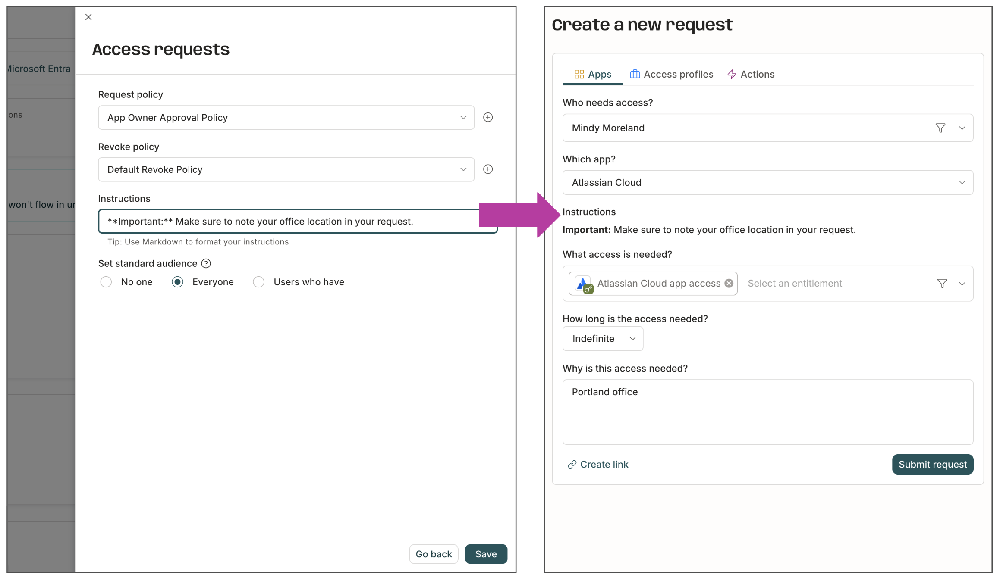
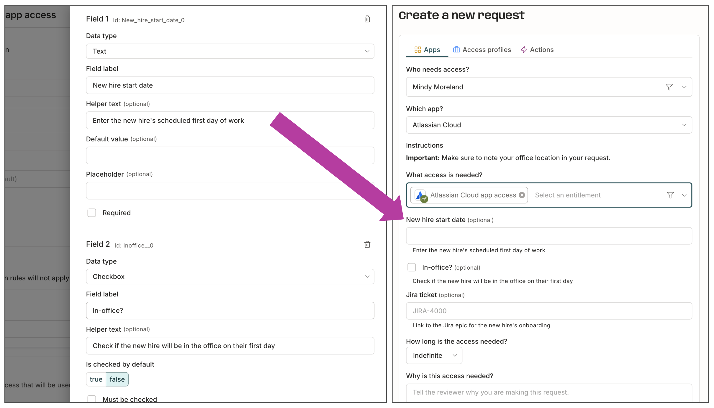
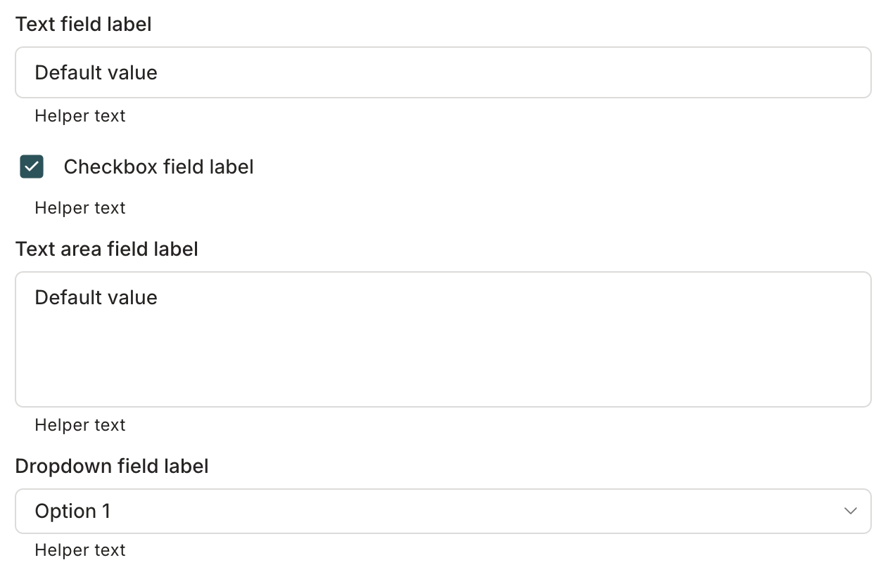
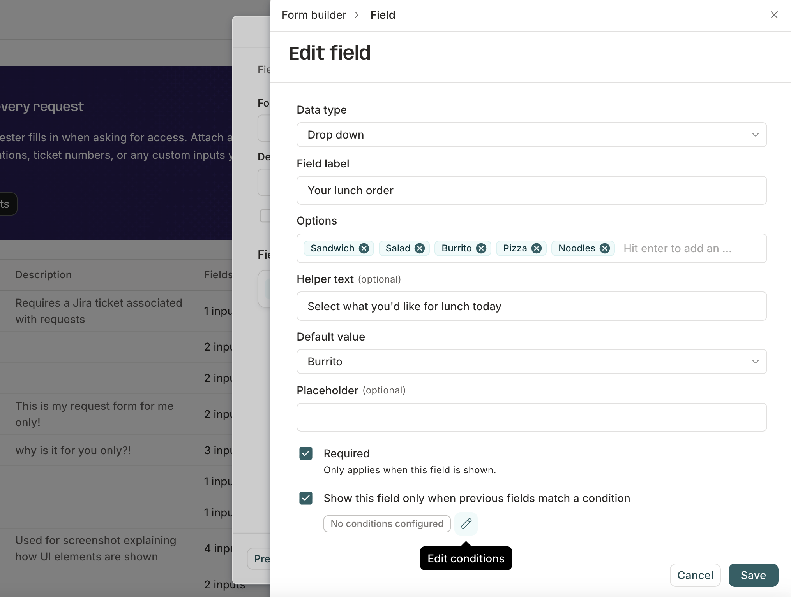
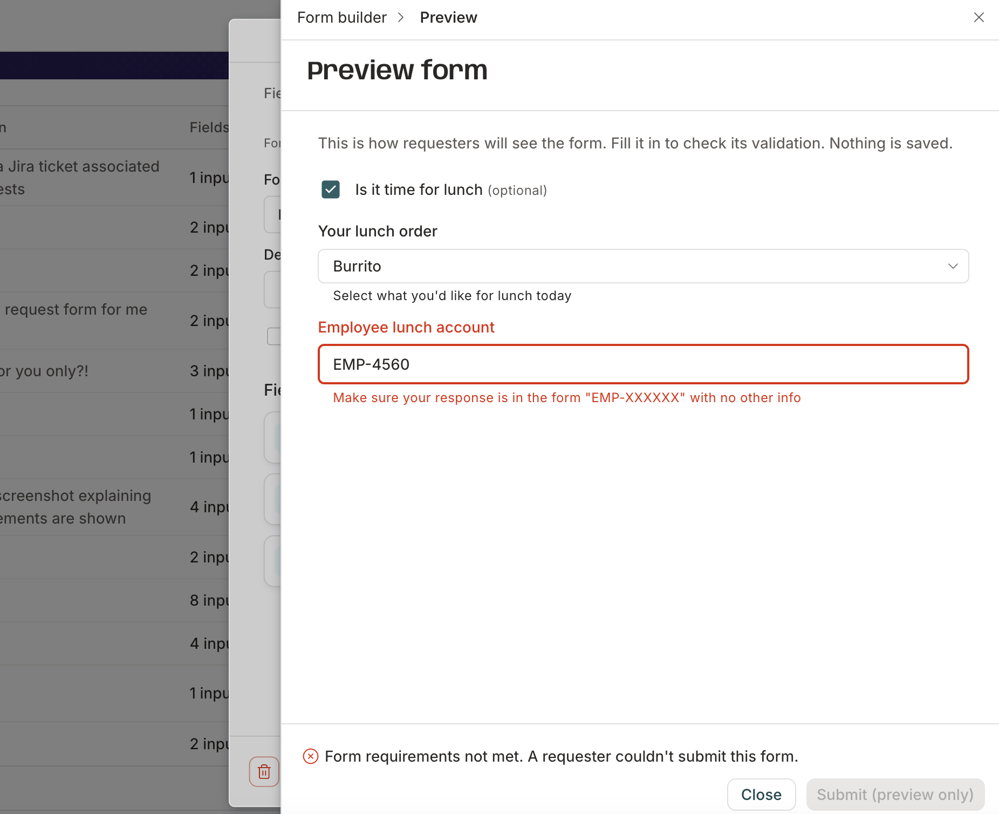

{/* Editor Refresh: 2026-11-19 */}

## Provide instructions to requestors

You can set instructions on each application that will be shown to users when they request new access in the web UI or in Slack. 

<Frame>

</Frame>

<Warning>
A **Super Admin** or an application owner with the **Application Admin** role in C1 must complete this task. 
</Warning>

<Steps>
<Step>
Navigate to the **Apps** page.
</Step>

<Step>
On the **Applications** tab, select an application. 
</Step>

<Step>
Locate the **Access requests** card and click **Edit**. 
</Step>

<Step>
Add app-specific request instructions to the **Instructions** field. You can format your instructions using Markdown to add emphasis, links, and structure. 
</Step>

<Step>
Click **Save**. 
</Step>
</Steps>

**Done.** Users requesting entitlements in this app will be shown your instructions. 

## Collect additional information from requestors using request forms 

Request forms collect the extra information an approver or provisioner needs when someone requests access. You can make a field required, show it only when earlier answers make it relevant, and check text answers against a pattern before the request is submitted. Request forms also appear in the [C1 app for Slack](/product/admin/integration-for-Slack)'s request and extend-access modals, so Slack requesters see and fill the same fields as requesters using the web UI. (Request forms are not currently supported in Teams.) 

<Frame>

</Frame>

Request forms can help with: 

* **Financial tracking**: Require users to provide a project name or cost center so access can be accurately allocated and billed.

* **Compliance and licensing**: Ask for the user's country or region to ensure they are assigned the correct software licenses and permissions in line with local regulations and licensing agreements.

* **Onboarding**: A manager requesting access for a new hire can provide the new employee's start date in a request form. This lets the IT team pre-stage accounts and resources, ensuring everything is ready for day one.

* **Change management**: Require a ticket number or link. This ties the access request directly to an existing change management process, providing an audit trail for all approved permissions.

If [external ticketing](/product/admin/external-ticketing) is configured, information gathered by a request form will be included in provisioning tickets created in the ticketing system. You can also use the field ID automatically assigned to each request form field when [customizing external ticketing templates](/product/admin/external-ticketing#customizing-ticket-templates).

### View and manage all forms

The **Platform > Forms** page lists all request forms in your C1 tenant in one place. From here you can create new forms, open any existing form to review or edit its fields, and see which entitlements each form is assigned to — without navigating through individual apps and entitlements.

### Configure tenant-wide request settings

Navigate to **Platform > Forms** and select **Global request settings** from the **...** (more actions) menu to open a drawer with settings that apply across all access requests in your tenant:

- **Require and show justification field for access requests** — require all requesters to provide a justification.
- **Maximum entitlements per bulk request** — the most entitlements a user can select in a single bulk access request, from 1 to 100. Defaults to 10.

### Create a new request form

<Warning>
A **Super Admin** in C1 must complete this task. 
</Warning>

Each entitlement can use only one request form at a time. 

<Steps>
<Step>
Navigate to **Platform > Forms**.
</Step>
<Step>
Click **New form**. The form creation drawer opens.
</Step>
<Step>
Give the new form a name and description. 

   This form will be available as an option across your C1 installation, so choose a name that will help your colleagues understand the form's purpose. 
</Step>
<Step>
**Optional.** If you want to hide the default **Justification** field when this request form is in use, click to enable **Hide justification field**. If you leave this disabled, the **Justification** field will be included in the request form.  
</Step>
<Step>
An **Untitled field** is automatically added to the form when you create it. Click it to open the field drawer and configure it, or click **Add field** to add an additional field.
</Step>
<Step>
Select the data type for your field. See [Field types](#field-types) for the options.
</Step>
<Step>
Fill in the field label and provide Drop down options, helper text, a default value, and a placeholder, as needed. The helper text field supports Markdown — use it to add links, bold text, or lists to guide requesters. The required and available elements vary by field type. Here's an overview of how and where these elements are shown in the access request:

   <Frame>
   
   </Frame>

   For **Text** and **Text area** fields, you can also fill in the **Character limit (optional)** field. Requesters can't submit a value longer than the limit. 
   
   To check answers against a pattern, see [Validate text answers with a regex](#validate-text-answers-with-a-regex).

   For a **Date** field, set an earliest and latest allowed date, if needed. Each bound can be a fixed calendar date or a number of days relative to today — for example, capping a contractor's access end date at no more than a year out stays accurate over time instead of going stale. You can also set the field to default to today's date.

   For a **User** field, choose whether requesters can select one user or several (with optional minimum and maximum selection limits). Narrow the searchable list with an allowlist or exclude list of specific users, and choose whether deactivated users are selectable.
</Step>
<Step>
Choose whether the field is required. A user cannot submit a request if a required field has not been filled out. 

<Tip>
**C1 will always gather required information.** If a request is created without collecting the required information, the request task will be assigned to the user so they can provide the required information before the request approval process begins. This can happen when a request is created in Microsoft Teams (which does not currently support request forms), or when multiple entitlements are requested at once. 
</Tip>
</Step>
<Step>
**Optional.** To show a field only when earlier answers make it relevant, see [Show fields only when conditions are met](#show-fields-only-when-conditions-are-met).
</Step>
<Step>
When you're satisfied, click **Save** to save the field. 
</Step>
<Step>
As needed, click **Add field** and repeat the steps above to add additional fields. 
</Step>
<Step>
When you're satisfied, click **Save** to save the form. 
</Step>
</Steps>

**Done.** To apply the new form to entitlements, see [Apply a request form to entitlements](#apply-a-request-form-to-entitlements).

<Tip>
You can also open the form creation drawer from within an entitlement: navigate to the entitlement's **Access requests** section, click **Edit**, then select **Create new** from the **Request form** dropdown.
</Tip>

### Field types

| Field type | What requesters see | Can trigger a condition | Supports regex validation |
|---|---|---|---|
| **Text** | A single-line text field | Yes | Yes |
| **Text area** | A multi-line text field | Yes | Yes |
| **Checkbox** | A checkbox | Yes | No |
| **Drop down** | A list of options you define | Yes | No |
| **Date** | A date picker | Yes | No |
| **User** | A searchable dropdown of C1 users | Yes | No |

### Show fields only when conditions are met

<Warning>
A **Super Admin** in C1 must complete this task. 
</Warning>

A long form asks every requester every question, including ones that might not apply. A conditional field appears only when answers to earlier fields meet a condition you set. For example, show **Justification** only when **Reason** is `Testing` or `Other`, or ask for a **Ticket link** only when **Change request** is checked.

Conditions work on request forms. A field can have several conditions, and it appears only when all of them are met.

#### Set a condition on a field

You set conditions on the field that should appear or disappear, not on the field that triggers it. The first field in a form can't have a condition, because there are no earlier fields to look at.

<Steps>
<Step>
Navigate to **Platform > Forms** and open the form, or create a new one.
</Step>
<Step>
Click the field you want to show conditionally. The field's drawer opens.
</Step>
<Step>
Select **Show this field only when previous fields match a condition**. 

   <Frame>
   
   </Frame>
</Step>
<Step>
Click the **Edit conditions** (pencil) icon. The **Show *field name* when** drawer opens.
</Step>
<Step>
In the **Field** list, choose the earlier field to check. The list shows only fields above this one.
</Step>
<Step>
In the **Condition** list, choose how that field must be answered. The options depend on the field's type (see [Condition types](#condition-types)).
</Step>
<Step>
If you chose **is one of**, enter one or more entries in **Values**. Press Enter after each entry, or for a **Drop down** field, pick from that field's options. The field appears when the answer matches any of the values.
</Step>
<Step>
**Optional.** To require another earlier field as well, click **Add condition** and repeat the previous three steps. The field appears only when all conditions are met. Each earlier field can be used in one condition.
</Step>
<Step>
Click **Save** to save the condition. 
</Step>
<Step>
Click **Save** in the form drawer.
</Step>
</Steps>

**Done.** The field now shows a note on its card, and requesters see it only when the conditions are met. To test the conditions before you save, see [Preview a form before you save it](#preview-a-form-before-you-save-it).

To change a condition, reopen the field and click the **Edit conditions** icon. To remove all conditions, clear the **Show this field only when previous fields match a condition** checkbox.

#### Condition types

The conditions you can choose depend on the type of the field you're checking:

| Field being checked | Conditions available |
|---|---|
| **Text** | **is filled in**, **is one of** |
| **Drop down** | **is filled in**, **is one of** (choose from the field's own options) |
| **Checkbox** | **is checked**, **is unchecked** |
| **Text area**, **Date**, **User** | **is filled in** |

Matching for **is one of** is exact and case-sensitive: `Testing` doesn't match `testing`. For Text fields, list every spelling you want to accept, or use a **Drop down** field as the trigger so requesters can't vary the answer.

#### How conditions behave

- **Only earlier fields can be used.** If you try to move a field above one its condition depends on, or move a field below one that depends on it, C1 prevents the move. Reorder the fields or change the condition first.
- **Conditions chain.** A hidden field counts as unfilled for conditions that come after it. If field B shows only when field A is filled in, and field C shows only when field B is filled in, hiding A hides B and C.
- **Hidden fields aren't required and aren't validated.** A required field that's hidden doesn't block the request. C1 ignores any value sent for a hidden field and leaves it out of the request data, including data sent to [external ticketing](/product/admin/external-ticketing).
- **Requesters keep what they typed.** If a requester changes an earlier answer so a field disappears, then changes it back, the field returns with their earlier answer.
- **Approvers see only what the requester saw.** The **Requested data** view on a task omits fields that were hidden from the requester.
- **Edits keep conditions consistent.** Renaming a field's label updates the conditions that use it. Other changes adjust them for you:
  - If you remove a field that a condition checks, C1 drops that part of the condition. When no parts remain, the condition turns off.
  - If you change the type of a field that a condition checks, and the new type doesn't support the condition, the condition resets to the new type's default, such as **is checked** for a Checkbox. If the new type can't trigger conditions at all, C1 drops that part of the condition.
  - If you remove a Drop down option that a condition uses, C1 removes that value from the condition. If no values remain, the condition shows an error until you add one.
- **Changes apply everywhere the form is used.** Changing a form's conditions updates every entitlement that uses it.

#### Conditions in Slack

In the Slack request and extend-access modals, conditional fields appear and disappear as the requester answers earlier fields. A field a condition hides isn't required, and C1 ignores any value for it. Slack redraws the modal as the answers change, so a requester typing in a Text field may notice the form update while they type.

### Validate text answers with a regex

<Warning>
A **Super Admin** in C1 must complete this task. 
</Warning>

Use a regular expression (regex) when an answer has to follow a format, such as a ticket ID (`CHG-` followed by digits), a cost center code, or a company email domain. C1 checks the answer as the requester types and again when they submit, and blocks the request if the answer doesn't match. Regex validation is available on **Text** and **Text area** fields.

<Steps>
<Step>
Navigate to **Platform > Forms** and open the form, or create a new one.
</Step>
<Step>
Click a **Text** or **Text area** field, or add one. 
</Step>
<Step>
In **Input validation (via regex)**, enter your pattern. For example, `^CHG-[0-9]{6}$` accepts `CHG-123456` and rejects everything else.
</Step>
<Step>
**Optional.** In **Custom error message**, enter the text requesters see when their answer doesn't match. For example, `Enter a change ticket ID like CHG-123456.` If you leave this blank, C1 shows a default message that includes the pattern itself.
</Step>
<Step>
Click **Save**. If the pattern isn't valid, C1 rejects it with an error that describes the problem.
</Step>
</Steps>

**Done.** Requesters see your message beneath the field whenever their answer doesn't match. To try your pattern before you save, see [Preview a form before you save it](#preview-a-form-before-you-save-it).

<Frame>

</Frame>

#### Regex rules and limits

- **C1 uses RE2 syntax.** RE2 doesn't support lookahead, lookbehind, or backreferences. A pattern that uses them is rejected when you save.
- **A pattern matches anywhere in the answer.** To require the whole answer to match, anchor the pattern with `^` at the start and `$` at the end. Without anchors, `[0-9]{6}` accepts `abc123456xyz`.
- **Patterns are limited to 512 characters, and error messages to 256.**
- **Blank answers aren't checked.** A pattern applies only to answers that are filled in. A blank optional field passes, and a blank required field fails as missing, not as a mismatch.
- **Existing patterns stay enforced.** Forms that already had a pattern keep validating answers.

### Preview a form before you save it

Use the preview to try a form the way a requester will, including its conditions and regex validation, without saving the form or submitting a request. The preview reflects your unsaved changes.

{/* TODO (optional): screenshot of the Preview form button at the bottom of the form builder drawer. */}

<Steps>
<Step>
Navigate to **Platform > Forms** and open the form, or create a new one.
</Step>
<Step>
Click **Preview form** at the bottom of the form drawer. The button is available once the form has at least one field. If a field has errors, fix them first. The preview opens only when the fields are valid.
</Step>
<Step>
Fill in the form as a requester would. Conditional fields appear and disappear as you answer, and text answers are checked against their patterns.
</Step>
<Step>
Check the status at the bottom of the preview. It reads **Form requirements met** when a requester could submit the form, or **Form requirements not met** when they couldn't.
</Step>
<Step>
Click **Close**.
</Step>
</Steps>

**Done.** **Submit (preview only)** becomes available when the requirements are met, but it doesn't submit anything. Nothing from the preview is saved.

### Apply a request form to entitlements

#### Apply a form to one entitlement

<Warning>
A **Super Admin** or an application owner with the **Application Admin** role in C1 must complete this task. 
</Warning>

Request forms are set on individual entitlements, so users are asked for information specific to the access they're requesting. 

<Steps>
<Step>
Navigate to the **Apps** page.
</Step>
<Step>
On the **Managed apps** tab, select an application, then click **Entitlements**.
</Step>
<Step>
Locate and click on the name of an entitlement you want to add a request form to. 
</Step>
<Step>
On the entitlement's details page, locate the **Access requests** section and click **Edit**. 
</Step>
<Step>
In the **Request form** section, use the dropdown to select an existing request form that will be applied to this entitlement. To create a new form instead, see [Create a new request form](#create-a-new-request-form). 
</Step>
<Step>
When you're ready, click **Save** to apply your chosen form to access requests for the entitlement. 
</Step>
</Steps>

**Done.** The request form will now be shown whenever a user requests this entitlement via the **Requests** page or the **New request** form. 

#### Apply a form to several entitlements in an app

You can use a bulk-actions shortcut to set the same request form on multiple entitlements: 

<Steps>
<Step>
Navigate to the **Apps** page.
</Step>
<Step>
On the **Managed apps** tab, select an application, then click **Entitlements**.
</Step>
<Step>
Use the checkboxes on the left of the screen to select the entitlements that you want to add the request form to, then choose **Set access requests** from the bulk actions menu at the bottom of the table. 
</Step>
<Step>
Find the **Request form** area at the bottom of the configuration drawer and select the request form you want to apply to these entitlements. 
</Step>
<Step>
Click **Submit**.
</Step>
</Steps>

**Done.** The request form will now be shown whenever a user requests one of the selected entitlements via the **Requests** page or the **New request** page. 

### Modify a request form 

<Warning>
A **Super Admin** in C1 must complete this task. 
</Warning>

<Steps>
<Step>
Navigate to **Platform > Forms**.
</Step>
<Step>
Click the name of the form you want to modify. The editing drawer opens.
</Step>
<Step>
Make your changes, including to [conditions](#show-fields-only-when-conditions-are-met) and [regex validation](#validate-text-answers-with-a-regex). When you're ready, click **Save** to exit the editing drawer.
</Step>
</Steps>

**Done.** Your changes to the form will be pushed to all entitlements currently using the form. The count of these entitlements, if relevant, is shown in a banner at the bottom of the drawer.

<Tip>
You can also open the editing drawer from within an entitlement: navigate to the entitlement's **Access requests** section, click **Edit**, select a form from the **Request form** dropdown, then click **Modify**.
</Tip>
